

<h1>NerdOctaxe Gamma Rev 3.1</h1>
<h3>Informe de configuraciones óptimas</h3>

Pruebas de frecuencia, voltaje y refrigeración en una unidad con NerdOS v1.1.0.1

<table align="center">
<tr>
<td align="center" width="240">IDEAL <b>600 MHz · 1,13 V</b> ASIC a 55 °C  <b>15,56 J/TH</b> 9,69 TH/s · 150,8 W 13,03 €/mes</td>
<td align="center" width="240">MÁS EQUILIBRADA <b>650 MHz · 1,17 V</b> ASIC a 55 °C  <b>16,40 J/TH</b> 10,58 TH/s · 173,5 W 14,99 €/mes</td>
<td align="center" width="240">DEFECTO DE FÁBRICA <b>700 MHz · 1,21 V</b> ASIC a 55 °C  <b>17,02 J/TH</b> 11,40 TH/s · 194,0 W 16,76 €/mes</td>
</tr>
</table>

&nbsp;

## Contenido

1. [Resumen y conclusiones](#resumen-y-conclusiones)
2. [Equipo y montaje](#equipo-y-montaje)
3. [Metodología y criterios](#metodología-y-criterios)
4. [Resultados de las 18 pruebas](#resultados-de-las-18-pruebas)
5. [Hallazgos](#hallazgos)
6. [Configuración ideal y punto más equilibrado](#configuración-ideal-y-punto-más-equilibrado)
7. [Perfiles por prioridades](#perfiles-por-prioridades)
8. [Proyección de verano](#proyección-de-verano)
9. [Limitaciones y advertencias](#limitaciones-y-advertencias)
10. [Apéndice A: datos anteriores a la reparación y al montaje actual](#apéndice-a-datos-anteriores-a-la-reparación-y-al-montaje-actual)
11. [Apéndice B: fórmulas, definiciones y fuentes](#apéndice-b-fórmulas-definiciones-y-fuentes)

> [!TIP]
> Los pesos de este informe son los del autor. En el [configurador interactivo](https://function0xmarki.github.io/Nerd-Octaxe-tuning/) puedes elegir tus propias prioridades, la temperatura de tu habitación y el precio de tu electricidad, y recalcula el ranking y el gasto con los mismos datos.

&nbsp;

## Resumen y conclusiones

Con el orden de prioridades cuidado de componentes, eficiencia y hashrate, la configuración ideal para este montaje es **600 MHz / 1,13 V con el ASIC a 55 °C**; el punto más equilibrado entre los tres criterios es **650 MHz / 1,17 V con el ASIC a 55 °C**.

Los datos salen de 18 pruebas en una sola unidad, con medias de 1 h del panel y sesiones largas de 4 a 20 h. Los criterios, los pesos y los límites de seguridad están en la sección de [metodología](#metodología-y-criterios) y las cifras no se extrapolan a otras unidades.

| Perfil | Configuración (ASIC a 55 °C) | TH/s | W | J/TH | €/mes | M2 / M1 (%) | Entrada (A) | Rechazados |
| --- | --- | --- | --- | --- | --- | --- | --- | --- |
| **Ideal** (cuidado, eficiencia, hashrate) | 600 MHz / 1,13 V | 9,69 | 150,8 | 15,56 | 13,03 | 42 / 31 | 12,7 | 0,40% |
| Alternativa con más hash | 625 MHz / 1,15 V | 10,14 | 161,3 | 15,91 | 13,94 | 46 / 32 | 13,6 | 0,42% (medido a 50 °C) |
| **Más equilibrada** | 650 MHz / 1,17 V | 10,58 | 173,5 | 16,40 | 14,99 | 48 / 35 | 14,5 | 0,39% |
| Máxima potencia sostenible (defecto de fábrica) | 700 MHz / 1,21 V | 11,40 | 194,0 | 17,02 | 16,76 | 67 / 48 | 16,9 | 0,51% |

El coste usa los vatios del panel con 0,12 €/kWh, 24 h × 30 días: $C_{\mathrm{mes}} = P \times 0{,}0864$. Con otro precio $p$ en €/kWh, $C_{\mathrm{mes}} = P \times 0{,}72 \times p$; el configurador lo calcula con el tuyo.

- **Eficiencia frente al defecto:** 600 MHz da un 15,0% menos de hash, un 22,3% menos de potencia (3,73 €/mes menos) y un 8,6% mejor J/TH que 700 MHz / 1,21 V.
- **Coste de la potencia:** de 600 a 725 MHz el hash sube un 21,9% (9,69 a 11,81 TH/s) y el gasto un 36,9% (13,03 a 17,84 €/mes). Cada TH/s adicional cuesta unos 26 J.
- **Voltaje:** a 700 MHz, 1,22 V no mejora el hash ni los rechazados (0,65% frente a 0,51%) y cuesta 4,3 W más. A 675 MHz, 1,20 V bajó los rechazados de 0,72% a 0,44% por 4,0 W más, un indicio moderado.
- **Temperatura del ASIC:** bajar el target de 55 a 52 °C ahorra 4 a 5 W y mantiene el hash, pero sube M2 del 46-48% al 71-72%. A 50 °C el hash baja un 0,7% a 650 MHz y un 1,1% a 625 MHz, y M2 llega al 81-91%.
- **Entrada eléctrica:** la tensión baja a 11,8 V desde 15,9 A. A 725 MHz la corriente llega a 17,81 A, a 0,19 A del límite de 18 A.
- **Verano:** el defecto de fábrica mantiene el ASIC en 55 °C solo hasta unos 26 °C de habitación; 600 MHz llega a unos 32 °C.

<picture>
  <source media="(prefers-color-scheme: dark)" srcset="assets/eficiencia-dark.svg">
  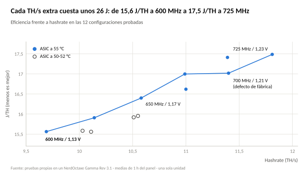
</picture>

&nbsp;

## Equipo y montaje

Todas las pruebas son de una sola unidad, ya reparada y con ventiladores propios: las cifras valen para este montaje y no para el equipo de serie.

| Elemento | Detalle |
| --- | --- |
| Equipo | NerdOctaxe Gamma Rev 3.1 de Bitronics, 8 × BM1370, con el circuito snubber mejorado como la Rev 3.2 (dato de BitMaker, sin documentación pública) |
| Alimentación del chip | VRM de 6 fases con controlador TPS53667 (descripción de Bitronics) |
| Firmware | NerdOS v1.1.0.1; valor de fábrica 700 MHz / 1,21 V |
| Fuente | 12 V 20 A por XT60; la tensión de entrada marca 11,8-11,9 V en carga |
| Pool | pool.bitronics.store:3443 (SV1), ping de 67 a 103 ms |
| Ventiladores | Canal M2 (ASIC): 2 × Thermalright TL-9015B en las torres (modelo deducido, no confirmado por Bitronics). Canal M1 (VR): 2 × Noctua NF-A9x14 PWM traseros. Cada par en su cable Y, sin alargadores |
| Control | PID separado: ASIC a 50, 52 o 55 °C según la prueba, VR a 50 °C, apagado a 70 °C en ambos |
| Entorno | Habitación de 22 a 25 °C, ventana cerrada; puerta abierta o cerrada anotada en cada prueba |
| Coste eléctrico | 0,12 €/kWh, 24 h × 30 días: €/mes = W × 0,0864. La columna "pared" suma un 15% supuesto, sin medir |

La unidad se quemó una vez y el fabricante la reparó: reforzó el circuito snubber y añadió disipadores de aluminio pasivos en los VR. Los datos anteriores a esa reparación van aparte, en el [Apéndice A](#apéndice-a-datos-anteriores-a-la-reparación-y-al-montaje-actual).

> [!IMPORTANT]
> Con la refrigeración de serie, sin los Noctua traseros, el VR dependería solo del aire de las torres. Ese caso no está validado y estos valores no se le aplican.

&nbsp;

## Metodología y criterios

Cada prueba cambió una sola variable, se dejó estabilizar y se leyó el panel de NerdOS; los criterios de aprobado y los límites de seguridad los fijó el autor y no son valores del fabricante.

- **Lectura:** media de 1 h de la gráfica (el valor instantáneo oscila ±0,05 TH/s), vatios y corriente del panel, temperatura de la habitación con termómetro y XT60 al tacto (fresco, tibio o caliente, sin grados).
- **Duración:** las lecturas finales van de 4 a 20 h de uptime según la prueba; y las de cambio de target del ASIC, de 1,5 a 3 h.
- **Rechazados:** se juzgan con más de 2.000 shares y, cuando se pudo, tras reiniciar para partir de cero. Las pruebas 3, 4, T1, T2c y T3-B se aplicaron en caliente: su contador mezcla sesiones y se calculó por diferencia entre capturas, o se marca **n. c.**
- **Hashrate esperado:** el panel lo calcula como MHz × 16,32 GH/s.
- **Repetibilidad:** pruebas idénticas difieren 0,1-0,5% en hash y hasta 1 W en consumo.

### Límites de seguridad

| Variable | Objetivo | Parar si |
| --- | --- | --- |
| VRT exterior | ≤55 °C | >60 °C durante 10 min, o >65 °C |
| ASIC | ≤55-58 °C | >60 °C |
| Ventilador M2 (ASIC) | ≤85% | >85% sin alcanzar el target |
| Tensión de entrada | ≥11,8 V | <11,5 V |
| Corriente de entrada | ≤18 A | >18 A |
| Rechazados | ≤0,5% estable; 0,5-1,0% aviso | >1,0% |
| Apagado por firmware | 70 °C en ASIC y VR | no subirlo |

### Criterio de aprobado

1. Hashrate de la media de 1 h ≥97% del esperado.
2. Rechazados ≤0,5% con al menos 2.000 shares.
3. VRT exterior ≤60 °C y ASIC en su target, con M2 ≤85%.
4. Entrada ≥11,8 V y ≤18 A.
5. Sin reinicios ni errores.

### Cómo se puntúa

Cada configuración recibe de 0 a 100 en cada criterio, normalizado entre las configuraciones seguras: 0 para la peor y 100 para la mejor. Una configuración es segura si cumple M2 ≤85%, corriente ≤18 A y rechazados ≤1,0%. De las 12 configuraciones probadas en régimen estable, 11 lo son; solo 650 MHz / 1,17 V con el ASIC a 50 °C queda fuera, con M2 al 91%.

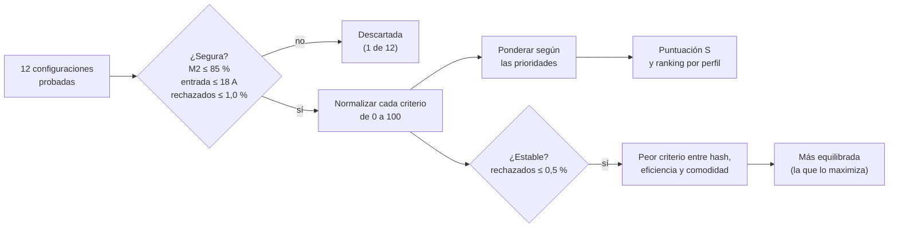

La puntuación de cada criterio y la ponderada son:

$$s_i = 100 \, \frac{x_i - x_{\min}}{x_{\max} - x_{\min}} \qquad\qquad S = \frac{\sum_k w_k \, s_k}{\sum_k w_k}$$

En los criterios donde menos es mejor (eficiencia, cuidado de componentes, coste y estabilidad) la escala se invierte, de modo que 100 es siempre la mejor.

| Criterio | Indicador | Mejor es |
| --- | --- | --- |
| Hashrate | $H \, (1 - r)$, TH/s con rechazados $r$ descontados | más alto |
| Eficiencia | $E = P / H$ en J/TH | más bajo |
| Cuidado de componentes | Media de dos subíndices: esfuerzo de ventiladores (media del % de M2 y M1) y corriente de entrada | más bajo |
| Temperatura | Ambiente máximo que sostiene el target con M2 ≤85%: $T_{\mathrm{ASIC}} - R \, P$ | más alto |
| Coste | €/mes con los vatios del panel | más bajo |
| Estabilidad | % de rechazados | más bajo |

Los pesos dependen de la posición que el usuario da a cada criterio:

| Criterios elegidos | 1 | 2 | 3 | 4 | 5 |
| --- | --- | --- | --- | --- | --- |
| Pesos por posición (%) | 100 | 60 / 40 | 50 / 30 / 20 | 40 / 30 / 20 / 10 | 35 / 25 / 20 / 12 / 8 |

El esfuerzo de ventiladores y la corriente son indicadores de desgaste y de estrés de los VR; no se midió el desgaste en sí.

&nbsp;

## Resultados de las 18 pruebas

Las 18 pruebas están en tres tablas con la misma numeración; **1** es la línea base y **T1** es una prueba de techo térmico con los ventiladores forzados al 100%, que no entra en las puntuaciones. Los mismos datos, en una sola tabla, están en [`data/pruebas.csv`](data/pruebas.csv).

### Rendimiento

| # | MHz / V | ASIC (°C) | TH/s | W | J/TH | Rechazados | TH/s efectivos | Shares (rechazados) |
| --- | --- | --- | --- | --- | --- | --- | --- | --- |
| 1 | 625 / 1,15 | 52 | 10,11 | 157,3 | 15,56 | 0,40% | 10,07 | 2.749 (11) |
| 2 | 650 / 1,17 | 52 | 10,51 | 168,5 | 16,03 | 0,28% | 10,48 | 6.422 (18) |
| 2b | 650 / 1,17 | 55 | 10,57 | 172,8 | 16,35 | 0,36% | 10,53 | 12.402 (45) |
| 3 | 675 / 1,19 | 55 | 11,00 | 182,8 | 16,62 | 0,72% | 10,92 | 6.639 (48) |
| 3b | 675 / 1,20 | 55 | 10,99 | 186,8 | 17,00 | 0,44% | 10,94 | 12.498 (55) |
| 4 | 700 / 1,21 | 55 | 11,40 | 193,5 | 16,97 | 0,67% | 11,32 | 1.944 (13) |
| 4R | 700 / 1,21 | 55 | 11,41 | 193,5 | 16,96 | 0,55% | 11,35 | 7.174 (40) |
| 4b | 700 / 1,22 | 55 | 11,39 | 198,3 | 17,41 | 0,65% | 11,32 | 8.191 (53) |
| 5 | 725 / 1,23 | 55 | 11,81 | 206,5 | 17,49 | 0,61% | 11,74 | 14.351 (88) |
| 6 | 600 / 1,13 | 55 | 9,70 | 150,8 | 15,55 | 0,34% | 9,67 | 4.342 (15) |
| T2 | 625 / 1,15 | 50 | 10,03 | 156,3 | 15,58 | 0,42% | 9,99 | 14.297 (61) |
| T2c | 625 / 1,15 | 55 | 10,14 | 161,3 | 15,91 | - | 10,10 | – |
| T1 | 700 / 1,21 | 50 (ventiladores al 100%) | 11,43 | 192,5 | 16,84 | n. c. | – | – |
| V1 | 650 / 1,17 | 55 | 10,58 | 173,5 | 16,40 | 0,42% | 10,54 | 15.276 (64) |
| V2 | 600 / 1,13 | 55 | 9,69 | 150,8 | 15,56 | 0,41% | 9,65 | 19.576 (81) |
| T3-A | 650 / 1,17 | 50 | 10,51 | 167,3 | 15,92 | 0,59% (prov.) | – | 2.195 (13) |
| T3-B | 650 / 1,17 | 52 | 10,55 | 168,3 | 15,95 | 0,38% | 10,51 | 4.227 (16) |
| V3 | 700 / 1,21 | 55 | 11,40 | 194,0 | 17,02 | 0,49% | 11,34 | 28.423 (140) |

### Coste

| # | €/mes (panel) | €/mes (pared, +15%) | €/TH/mes | Δ €/mes frente al defecto (4R) |
| --- | --- | --- | --- | --- |
| 1 | 13,59 | 15,63 | 1,34 | -3,13 |
| 2 | 14,56 | 16,74 | 1,39 | -2,16 |
| 2b | 14,93 | 17,17 | 1,41 | -1,79 |
| 3 | 15,79 | 18,16 | 1,44 | -0,92 |
| 3b | 16,14 | 18,56 | 1,47 | -0,58 |
| 4 | 16,72 | 19,23 | 1,47 | 0,00 |
| 4R | 16,72 | 19,23 | 1,47 | 0,00 |
| 4b | 17,13 | 19,70 | 1,50 | +0,41 |
| 5 | 17,84 | 20,52 | 1,51 | +1,12 |
| 6 | 13,03 | 14,98 | 1,34 | -3,69 |
| T2 | 13,50 | 15,53 | 1,35 | -3,21 |
| T2c | 13,94 | 16,03 | 1,37 | -2,78 |
| T1 | 16,63 | 19,13 | 1,46 | -0,09 |
| V1 | 14,99 | 17,24 | 1,42 | -1,73 |
| V2 | 13,03 | 14,98 | 1,34 | -3,69 |
| T3-A | 14,45 | 16,62 | 1,38 | -2,26 |
| T3-B | 14,54 | 16,72 | 1,38 | -2,18 |
| V3 | 16,76 | 19,28 | 1,47 | +0,04 |

La columna "pared" suma un 15% supuesto para la pérdida de la fuente y los ventiladores, que el panel no cuenta. Los €/TH/mes son J/TH × 0,0864.

### Operación y condiciones

| # | M2 / M1 (%) | Entrada (V / A) | VRT int (°C) | Habitación (°C) | XT60 |
| --- | --- | --- | --- | --- | --- |
| 1 | 71 / 24 | 11,9 / 13,6 | 45,9 | – | – |
| 2 | 83 / 26 | 11,9 / 14,5 | 46,4 | ≈26 (est.) | tibio |
| 2b | 59 / 42 | 11,9 / 14,5 | 46,5 | 25 | tibio |
| 3 | 58 / 40 | 11,9 / 15,5 | 47,0 | 23 | templado |
| 3b | 65 / 45 | 11,8 / 15,9 | 47,1 | 24 | tibio |
| 4 | 67 / 44 | 11,8 / 16,4 | 47,4 | 23 | tibio |
| 4R | 65 / 45 | 11,8 / 16,4 | 47,1 | 23 | tibio |
| 4b | 66 / 43 | 11,8 / 16,9 | 47,4 | 23 | tibio |
| 5 | 81 / 50 | 11,8 / 17,8 | 47,8 | 23 | tibio |
| 6 | 40 / 30 | 11,9 / 12,7 | 45,9 | 23 | fresco |
| T2 | 81 / 17 | 11,9 / 13,1 | 45,8 | 23 | fresco |
| T2c | 46 / 32 | 11,9 / 13,6 | 46,5 | 23 | fresco |
| T1 | 100 / 100 | 11,8 / 16,4 | 41,4 | 23 | fresco |
| V1 | 48 / 35 | 11,9 / 14,5 | 47,0 | 23 | tibio |
| V2 | 42 / 31 | 11,9 / 12,7 | 46,4 | 22 | fresco |
| T3-A | 91 / 18 | 11,9 / 14,1 | 46,1 | 22,5 | tibio |
| T3-B | 72 / 25 | 11,9 / 14,5 | 46,4 | 24 | tibio |
| V3 | 67 / 48 | 11,8 / 16,9 | 47,8 | 24 | tibio |

El VRT exterior estuvo en 50,0 °C ±0,1 en todas las pruebas, que es su target, salvo T1 (43,9 °C con los ventiladores al máximo). La temperatura de la prueba 2 es una inferencia: no se anotó y se dedujo del ventilador, con una incertidumbre de unos 2 °C; la de la prueba 1 no se anotó.

&nbsp;

## Hallazgos

La eficiencia mejora de forma continua al bajar frecuencia y voltaje, el voltaje tiene un efecto pequeño salvo cerca del mínimo estable, y la temperatura del ASIC cambia sobre todo el trabajo de los ventiladores.

### Eficiencia y potencia

- **Curva de eficiencia:** 15,55-15,56 J/TH a 600 MHz, y lo mismo a 625 MHz con el ASIC a 52 °C; sube a 16,40 (650 MHz), 17,02 (700 MHz) y 17,49 (725 MHz). No hay un codo marcado: cada paso de 25 MHz cuesta entre 17 y 33 J por TH/s adicional (26 de media).
- **Modelo de potencia:** con $f$ en MHz y $V$ en voltios, reproduce los vatios de las 8 configuraciones con el ASIC a 55 °C con un error máximo de 2,7 W; con el ASIC a 50-52 °C da de 2,5 a 4,1 W de más, porque ese target ahorra 4 a 5 W. Sugiere unos 24 W de consumo base que no baja con la frecuencia; es un ajuste, no una medida.
- **Frente al defecto de fábrica:** 725 MHz suma 3,6% de hash por 6,4% más de potencia; 650 MHz resta 7,2% de hash y 10,6% de potencia (1,77 €/mes menos).

$$P \approx 24 + 0{,}165 \cdot f \cdot V^{2}$$

<picture>
  <source media="(prefers-color-scheme: dark)" srcset="assets/potencia-dark.svg">
  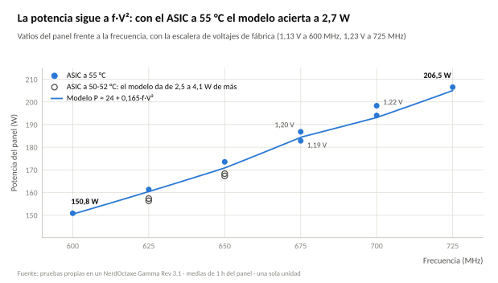
</picture>

<picture>
  <source media="(prefers-color-scheme: dark)" srcset="assets/relativo-dark.svg">
  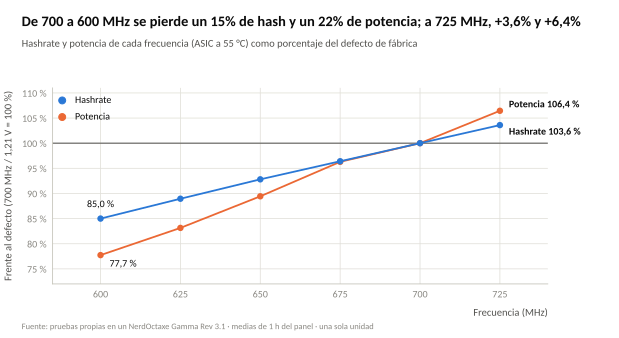
</picture>

### Voltaje y rechazados

- **700 MHz:** el valor de fábrica (1,21 V) da 0,51% con 35.597 shares (4R y V3). Con 1,22 V sale 0,65% con 8.191 shares: la diferencia de 0,14 puntos es de unos 1,5 errores estándar, dentro del ruido, con 4 a 5 W más.
- **675 MHz:** 1,19 V da 0,72% (6.639 shares) y 1,20 V da 0,44% (12.498 shares). La diferencia de 0,28 puntos es de unos 2,4 errores estándar: un indicio moderado de que 10 mV ayudan aquí.
- **Frecuencia:** los rechazados son 0,28-0,42% a 650 MHz y 0,34-0,42% a 600-625 MHz; suben hasta 700 MHz y quedan en torno a 0,6% a 725 MHz. La latencia con el pool (67 a 103 ms) influye, por lo que no son solo del chip.

### Temperatura del ASIC y hashrate

| Frecuencia / voltaje | ASIC 50 °C | ASIC 52 °C | ASIC 55 °C |
| --- | --- | --- | --- |
| 625 MHz / 1,15 V | 10,03 TH/s, M2 81% | 10,11 TH/s, M2 71% | 10,14 TH/s, M2 46% |
| 650 MHz / 1,17 V | 10,51 TH/s, M2 91% | 10,55 TH/s, M2 72% | 10,58 TH/s, M2 48% |
| 700 MHz / 1,21 V | 11,43 TH/s (ventiladores al 100%) | – | 11,40 TH/s, M2 67% |

<picture>
  <source media="(prefers-color-scheme: dark)" srcset="assets/ventilador-dark.svg">
  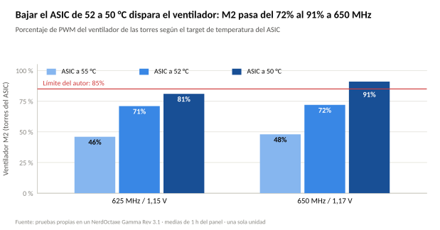
</picture>

- **Efecto sobre el hash:** a 625 MHz, el ASIC a 50 °C rinde un 1,1% menos que a 55 °C, y a 650 MHz un 0,7% menos. Hay tres observaciones coherentes en 625 MHz (el 18 de octubre, −1,3% al abrir la ventana; T2, −1,0%; T2c, +1,1% al volver a 55 °C). A 700 MHz no se notó. El mecanismo no se conoce.
- **Eficiencia:** el mejor J/TH está en 52 °C (15,56 a 625 MHz y 15,95 a 650 MHz, frente a 15,91 y 16,40 a 55 °C), con 4 a 5 W menos.
- **Ventilador:** por debajo de 52 °C cada grado pide muchos más puntos de PWM: a 650 MHz, M2 pasa del 72% al 91% entre 52 y 50 °C.

> [!NOTE]
> El efecto del ASIC frío sobre el hash (0,7 a 1,1%) queda cerca del ruido de repetición (0,1-0,5%). Es moderado a 625 MHz y no concluyente a 650 MHz.

### Ventiladores, entrada y XT60

- **M2:** unos 27 a 29 RPM por cada 1% de PWM, hasta 2.616 RPM al 100% con cada par de ventiladores en su propio cable Y. Con un alargador intermedio, M2 se quedaba en 1.735 RPM al 100%; se resolvió quitando el alargador.
- **M1 (Noctua traseros):** 2.067 RPM al 100% y 483 RPM al 18%, así que giran incluso con M1 bajo.
- **Tensión de entrada:** 11,9 V hasta 14,5 A y 11,8 V desde 15,9 A. A 725 MHz la corriente llega a 17,81 A.
- **XT60:** fresco hasta 13,6 A y tibio de 14,1 A en adelante, sin tendencia visible hasta 17,8 A. En T1 estaba fresco a 16,4 A tras solo 30 min, así que el calentamiento depende del tiempo de funcionamiento.

<picture>
  <source media="(prefers-color-scheme: dark)" srcset="assets/ventiladores-frecuencia-dark.svg">
  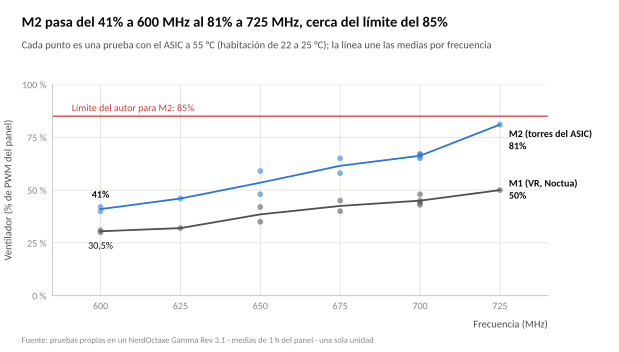
</picture>

<picture>
  <source media="(prefers-color-scheme: dark)" srcset="assets/corriente-dark.svg">
  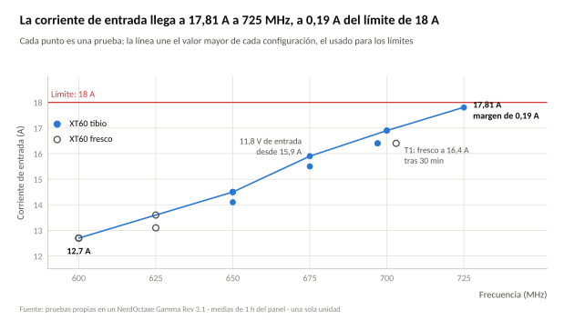
</picture>

### Repetibilidad

| Configuración | Sesiones | TH/s | W | M2 (%) a habitación |
| --- | --- | --- | --- | --- |
| 600 MHz / 1,13 V | 6 y V2 | 9,70 y 9,69 | 150,8 y 150,8 | 40 a 23 °C y 42 a 22 °C |
| 650 MHz / 1,17 V | 2b y V1 | 10,57 y 10,58 | 172,8 y 173,5 | 59 a 25 °C y 48 a 23 °C |
| 700 MHz / 1,21 V | 4, 4R y V3 | 11,40, 11,41 y 11,40 | 193,5, 193,5 y 194,0 | 67 a 23 °C, 65 a 23 °C y 67 a 24 °C |

El hash se repite dentro de 0,1% y los vatios dentro de 0,7 W. M2 depende de la habitación: a 650 MHz, 2 °C menos bajaron M2 11 puntos; a 700 MHz, 1 °C más lo subió 2 puntos, y a 600 MHz el efecto no se reprodujo. El termómetro tiene una incertidumbre de unos 2 °C.

&nbsp;

## Configuración ideal y punto más equilibrado

La configuración ideal para el orden cuidado, eficiencia, hashrate es **600 MHz / 1,13 V con el ASIC a 55 °C**, con 79,9 puntos sobre 100; el punto más equilibrado es **650 MHz / 1,17 V con el ASIC a 55 °C**.

### Cómo se definen

- **Ideal:** 50% cuidado de componentes y temperatura (25% cada uno), 30% eficiencia y 20% hashrate. Es el orden cuidado, eficiencia, hashrate con los pesos de tres prioridades.
- **Más equilibrada:** la configuración cuyo peor criterio entre hashrate, eficiencia y comodidad (media de cuidado y temperatura) es el mejor posible. Solo compiten las estables, con rechazados ≤0,5%.

$$S_{\mathrm{ideal}} = 0{,}25\,s_{\mathrm{cuidado}} + 0{,}25\,s_{\mathrm{temp}} + 0{,}30\,s_{\mathrm{efic}} + 0{,}20\,s_{\mathrm{hash}}$$

$$\text{equilibrio} = \max_{c}\ \min\!\bigl(s_{\mathrm{hash}},\ s_{\mathrm{efic}},\ s_{\mathrm{comodidad}}\bigr) \qquad s_{\mathrm{comodidad}} = \frac{s_{\mathrm{cuidado}} + s_{\mathrm{temp}}}{2}$$

### Ranking ideal

| Posición | Configuración | Puntuación | Hash | Eficiencia | Cuidado | Temperatura |
| --- | --- | --- | --- | --- | --- | --- |
| 1 | 600 MHz / 1,13 V · ASIC 55 °C | **79,9** | 0 | 100 | 100 | 100 |
| 2 | 625 MHz / 1,15 V · ASIC 55 °C | 70,9 | 21 | 82 | 87 | 81 |
| 3 | 625 MHz / 1,15 V · ASIC 52 °C | 65,2 | 20 | 100 | 72 | 52 |
| 4 | 625 MHz / 1,15 V · ASIC 50 °C | 59,0 | 16 | 99 | 75 | 30 |
| 5 | 650 MHz / 1,17 V · ASIC 55 °C | 58,7 | 43 | 56 | 74 | 59 |

Con cualquier reparto de pesos que mantenga el orden (cuidado y temperatura ≥ eficiencia ≥ hashrate), 600 MHz / 1,13 V gana en el 100% de 20.000 combinaciones aleatorias. Con pesos totalmente libres gana el 64%; el resto se reparte entre 625 MHz con el ASIC a 52 °C (12%), 725 MHz (11%, cuando casi todo el peso va al hashrate) y 625 MHz con el ASIC a 55 °C (4%).

> [!NOTE]
> Hay un sesgo de borde: 600 MHz es el límite inferior probado y la normalización lo coloca en el extremo (hash 0, eficiencia 100). Sin esa configuración, la ideal sería 625 MHz / 1,15 V con el ASIC a 55 °C. Además, la eficiencia ya no mejora de 625 a 600 MHz con el ASIC a 52 °C (15,56 y 15,55 J/TH): lo que se gana al bajar es potencia y esfuerzo de ventiladores. Por debajo de 600 MHz no se probó.

### Punto más equilibrado

| Configuración (estables) | Peor criterio | Hash | Eficiencia | Comodidad |
| --- | --- | --- | --- | --- |
| **650 MHz / 1,17 V · ASIC 55 °C** | **42,5** | 43 | 56 | 66 |
| 650 MHz / 1,17 V · ASIC 52 °C | 41,1 | 41 | 80 | 47 |
| 675 MHz / 1,20 V · ASIC 55 °C | 25,3 | 62 | 25 | 36 |

650 MHz / 1,17 V con el ASIC a 55 °C da 10,58 TH/s (7,2% menos que el defecto) con 173,5 W (10,6% menos), M2 al 48% y M1 al 35%, 14,5 A de entrada y un ambiente máximo de unos 29 °C. Sus 27.678 shares (pruebas 2b y V1) dan un 0,39% de rechazados: es la segunda medición más amplia, tras la del defecto de fábrica (35.597).

675 MHz / 1,19 V saldría marginalmente mejor (45,0), pero tiene 0,72% de rechazados, en zona de aviso, y queda fuera al exigir ≤0,5%.

### Puntuaciones por criterio

| Configuración | Hash | Eficiencia | Cuidado | Temperatura | Coste | Estabilidad |
| --- | --- | --- | --- | --- | --- | --- |
| 600 MHz / 1,13 V · ASIC 55 °C | 0 | 100 | 100 | 100 | 100 | 94 |
| 625 MHz / 1,15 V · ASIC 55 °C | 21 | 82 | 87 | 81 | 81 | 88 |
| 625 MHz / 1,15 V · ASIC 52 °C | 20 | 100 | 72 | 52 | 88 | 94 |
| 625 MHz / 1,15 V · ASIC 50 °C | 16 | 99 | 75 | 30 | 90 | 88 |
| 650 MHz / 1,17 V · ASIC 55 °C | 43 | 56 | 74 | 59 | 59 | 97 |
| 650 MHz / 1,17 V · ASIC 52 °C | 41 | 80 | 62 | 33 | 69 | 100 |
| 675 MHz / 1,19 V · ASIC 55 °C | 61 | 45 | 51 | 43 | 43 | 0 |
| 675 MHz / 1,20 V · ASIC 55 °C | 62 | 25 | 37 | 35 | 35 | 82 |
| 700 MHz / 1,21 V · ASIC 55 °C (defecto) | 81 | 24 | 23 | 22 | 22 | 62 |
| 700 MHz / 1,22 V · ASIC 55 °C | 80 | 4 | 28 | 15 | 15 | 21 |
| 725 MHz / 1,23 V · ASIC 55 °C | 100 | 0 | 0 | 0 | 0 | 32 |

La configuración 650 MHz / 1,17 V con el ASIC a 50 °C queda fuera por M2 al 91% y no se puntúa. Las puntuaciones son relativas a las 11 configuraciones seguras: cambian si se añaden o se quitan configuraciones.

<picture>
  <source media="(prefers-color-scheme: dark)" srcset="assets/puntuaciones-dark.svg">
  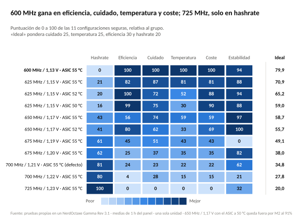
</picture>

&nbsp;

## Perfiles por prioridades

Cada perfil es un reparto de pesos sobre los mismos criterios; las tres mejores configuraciones de cada uno salen de la misma tabla de puntuaciones y se recalculan en el [configurador interactivo](https://function0xmarki.github.io/Nerd-Octaxe-tuning/) que acompaña al informe.

| Perfil | Pesos | 1.ª | 2.ª | 3.ª |
| --- | --- | --- | --- | --- |
| **Ideal** | cuidado 25, temperatura 25, eficiencia 30, hashrate 20 | 600 / 1,13 · ASIC 55 (79,9) | 625 / 1,15 · ASIC 55 (70,9) | 625 / 1,15 · ASIC 52 (65,2) |
| **Más equilibrada** | mejor peor-criterio entre hash, eficiencia y comodidad; rechazados ≤0,5% | 650 / 1,17 · ASIC 55 | 650 / 1,17 · ASIC 52 | 675 / 1,20 · ASIC 55 |
| **Máxima potencia** | hashrate 70, eficiencia 20, cuidado 5, temperatura 5 | 725 / 1,23 · ASIC 55 (70,0) | 700 / 1,21 · ASIC 55 (63,8) | 700 / 1,22 · ASIC 55 (58,8) |
| **Eficiente** | eficiencia 50, coste 30, cuidado 10, temperatura 10 | 600 / 1,13 · ASIC 55 (99,9) | 625 / 1,15 · ASIC 52 (89,0) | 625 / 1,15 · ASIC 50 (86,9) |
| **Cuidado máximo** | cuidado 40, temperatura 30, estabilidad 30 | 600 / 1,13 · ASIC 55 (98,2) | 625 / 1,15 · ASIC 55 (85,6) | 650 / 1,17 · ASIC 55 (76,4) |
| **Verano** | temperatura 50, cuidado 30, eficiencia 20 | 600 / 1,13 · ASIC 55 (100,0) | 625 / 1,15 · ASIC 55 (83,0) | 625 / 1,15 · ASIC 52 (67,9) |

<picture>
  <source media="(prefers-color-scheme: dark)" srcset="assets/perfiles-dark.svg">
  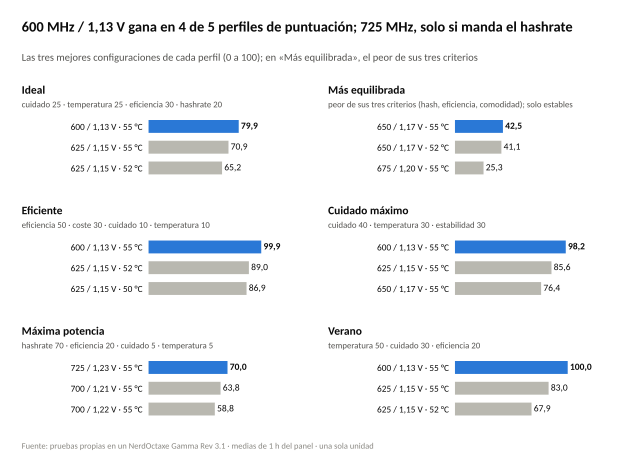
</picture>

> [!CAUTION]
> En "máxima potencia" la mejor puntuación es 725 MHz, pero no se recomienda para uso continuo: exige una habitación de ≤24 °C, deja 0,19 A de margen en la entrada (17,81 A) y M2 al 81%. El defecto de fábrica (700 MHz / 1,21 V) da el 96,5% de su hash con un 6,1% menos de potencia, y es la opción de máximo hash sostenible.

En "eficiente", 625 MHz con el ASIC a 52 °C iguala la eficiencia de 600 MHz (15,56 J/TH) con un 4,3% más de hash, a cambio de 6,5 W más y de M2 al 71%: su techo de habitación es de unos 28 °C con M2 al 85%, frente a unos 31 °C con el ASIC a 55 °C.

&nbsp;

## Proyección de verano

Con el ASIC a 55 °C y M2 ≤85%, 600 MHz / 1,13 V sostiene hasta unos 32 °C de habitación y el defecto de fábrica hasta unos 26 °C. Son estimaciones con una incertidumbre de ±2 a 3 °C.

$$T_{\mathrm{amb,max}} = T_{\mathrm{ASIC}} - R \times P \qquad\qquad \text{p. ej. } 55 - 0{,}150 \times 150{,}8 = 32{,}4\,{}^{\circ}\mathrm{C}$$

<picture>
  <source media="(prefers-color-scheme: dark)" srcset="assets/habitacion-dark.svg">
  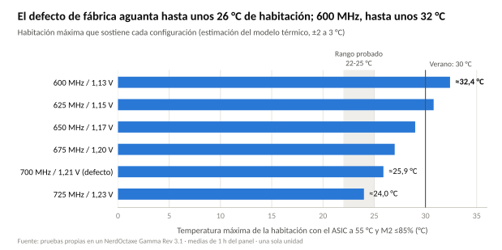
</picture>

| Configuración (ASIC 55 °C) | W | Ambiente máximo con M2 ≤85% | Con M2 al 100% |
| --- | --- | --- | --- |
| 600 MHz / 1,13 V | 150,8 | ≈32,4 °C | ≈33,7 °C |
| 625 MHz / 1,15 V | 161,3 | ≈30,8 °C | ≈32,3 °C |
| 650 MHz / 1,17 V | 173,5 | ≈29,0 °C | ≈30,5 °C |
| 675 MHz / 1,20 V | 186,8 | ≈27,0 °C | ≈28,7 °C |
| 700 MHz / 1,21 V | 194,0 | ≈25,9 °C | ≈27,6 °C |
| 725 MHz / 1,23 V | 206,5 | ≈24,0 °C | ≈25,9 °C |

<picture>
  <source media="(prefers-color-scheme: dark)" srcset="assets/resistencia-termica-dark.svg">
  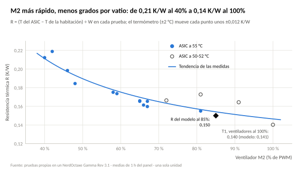
</picture>

<picture>
  <source media="(prefers-color-scheme: dark)" srcset="assets/verano-dark.svg">
  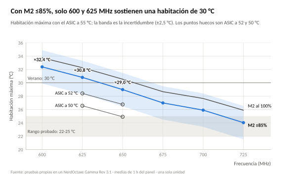
</picture>

- **Cálculo:** ambiente máximo = T del ASIC − R × W, con R = 0,150 K/W a M2 del 85% y 0,141 K/W al 100% (esta última, medida en T1 a 700 MHz). R sale de las medidas de 600 a 725 MHz, que van de 0,155 a 0,219 K/W según el ventilador.
- **Otro target:** cada grado que se baje el target del ASIC resta un grado al ambiente máximo, y el ahorro de 4 a 5 W devuelve unos 0,7 °C: con los vatios medidos, a 52 °C quedan de 2,2 a 2,4 °C menos y a 50 °C, de 4,1 a 4,3 °C menos (a 625 y 650 MHz). Subir el target a 58 °C añadiría unos 3 °C, pero no se probó.
- **VR:** no limita. Con los dos ventiladores al máximo, el VRT exterior marcó 43,9 °C con 23 °C de habitación; llegaría a 60 °C con unos 39 °C.
- **Uso práctico:** con 28 a 30 °C de habitación el defecto de fábrica ya no mantiene el ASIC en 55 °C; hay que bajar de frecuencia o subir el target. En invierno, con ≤23 °C, 625 y 650 MHz admiten el ASIC a 52 °C con M2 por debajo del 75%.

&nbsp;

## Limitaciones y advertencias

Los resultados valen para esta unidad, este montaje y este ambiente; quien los reproduzca debe medir los suyos antes de copiar un valor.

- **Una sola unidad:** un NerdOctaxe Rev 3.1, una fuente de 12 V 20 A (240 W nominales, con 206,5 W en el caso más alto), un pool y una habitación de 22 a 25 °C. Otra placa puede necesitar otro voltaje para la misma frecuencia.
- **Montaje:** el informe es válido con dos Noctua traseros en el canal de los VR y control separado de los dos ventiladores. Con la refrigeración de serie no se probó y no es el mismo valor.
- **Ventiladores:** los TL-9015B de las torres son una deducción a partir de una foto y de las RPM medidas; Bitronics no lo ha confirmado.
- **Vatios:** son los del panel. El 15% de la columna "pared" es un supuesto y no se midió con enchufe medidor.
- **Hash con el ASIC frío:** el efecto de 0,7 a 1,1% queda cerca del ruido de repetición (0,1-0,5%): moderado a 625 MHz, con tres observaciones coherentes, y no concluyente a 650 MHz.
- **Rechazados:** dependen también de la latencia con el pool (67 a 103 ms). La configuración de 625 MHz con el ASIC a 55 °C no tiene contador propio: se usó el de T2, a 50 °C. T3-A es provisional y T1 y T2c no tienen contador.
- **Corriente:** la lectura del panel puede diferir hasta 0,5 A de W ÷ V; para los límites se usó el valor mayor.
- **Duración desigual:** las lecturas van de 1,5 a 20 h; ninguna prueba duró 24 h seguidas.
- **Desgaste:** el porcentaje de los ventiladores y la corriente de entrada son indicadores, no medidas de vida útil. El fabricante no publica un límite de temperatura del VR; el de 60 °C es del autor.
- **Rango probado:** de 600 a 725 MHz, con saltos de 25 MHz y de 10 mV. No se buscó el voltaje mínimo estable de cada frecuencia, y no se probó por debajo de 600 MHz.
- **Verano:** la proyección se apoya en tres puntos de resistencia térmica y en un termómetro con ±2 °C; no se probó con una habitación por encima de 25 °C.

> [!WARNING]
> Subir frecuencia o voltaje puede dañar el hardware. Este informe no es una garantía del fabricante ni una recomendación de comprar o de minar.

&nbsp;

## Apéndice A: datos anteriores a la reparación y al montaje actual

Estos datos son de la placa antes de que el fabricante reforzara el circuito snubber y añadiera disipadores pasivos en los VR, con otro pool y otro montaje; no se mezclan con las puntuaciones.

| MHz / V | W (panel) | TH/s | J/TH | Rechazados | Nota |
| --- | --- | --- | --- | --- | --- |
| 700 / 1,18 | 184,8 | no fiable | – | – | ventilador al 100%; el hash se leyó de la escala de una gráfica y se descarta |
| 650 / 1,20 | 179,5 | – | – | – | |
| 650 / 1,17 | 172-174 | – | – | – | |
| 650 / 1,16 | 167,8 | – | – | 1,07% | |
| 650 / 1,15 | 166,5 | más bajo | – | 0,33% | hash más bajo que con 1,18 V |
| 650 / 1,18 | 177,3 | 10,635 | 16,67 | 0,00% (553 shares) | lectura corta |
| 650 / 1,18 | 177,0 | 10,610 | 16,68 | 0,17% (30.787 shares) | pool.bitronics.store:3333 |
| 625 / 1,16 | 162,8 | 10,172 | 16,00 | 0,06% (171.473 shares) | |

Solo los vatios son fiables en la fila de 700 MHz. Las filas de 650 / 1,18 y 625 / 1,16 son anteriores a la reparación y no se comparan con las de la placa actual: cambian la placa, el pool y el puerto.

Tras la reparación y antes del montaje actual, con los dos ventiladores enlazados al mismo porcentaje y el ASIC a 54-55 °C, la configuración de 625 MHz / 1,15 V dio 10,10-10,12 TH/s, 156,3-156,8 W y 15,39-15,59 J/TH, con el ASIC a 51-52 °C, el VRT exterior a 54-55 °C y los ventiladores al 71-78%. Los rechazados fueron 0,46-0,47% con 84.276 a 111.174 shares. Con el control separado actual, la misma configuración da 0,40-0,42% y el VRT exterior queda en 50 °C.

&nbsp;

## Apéndice B: fórmulas, definiciones y fuentes

Todas las cifras derivadas se calculan con estas fórmulas a partir de los datos del panel.

**Eficiencia** en J/TH, con $P$ en vatios y $H$ en TH/s:

$$E = \frac{P}{H}$$

**Coste mensual**, con 0,12 €/kWh × 24 h × 30 días:

$$C_{\mathrm{mes}} = P \times 0{,}0864$$

**Ambiente máximo**, con $R = 0{,}150$ K/W (M2 al 85%) o $R = 0{,}141$ K/W (M2 al 100%):

$$T_{\mathrm{amb,max}} = T_{\mathrm{ASIC}} - R \times P$$

**Puntuación** de cada criterio y puntuación ponderada:

$$s_i = 100 \times \frac{x_i - x_{\min}}{x_{\max} - x_{\min}} \qquad S = \frac{\sum_k w_k\, s_k}{\sum_k w_k}$$

**Modelo de potencia**, con $f$ en MHz y $V$ en voltios (error máximo 2,7 W con el ASIC a 55 °C):

$$P \approx 24 + 0{,}165 \cdot f \cdot V^{2}$$

- **M2 y M1:** ventiladores de las torres del ASIC y de los VR traseros, en porcentaje de PWM del panel.
- **VRT exterior e interior:** las dos lecturas del regulador de tensión; el control usa la exterior.
- **TH/s efectivos:** TH/s × (1 − rechazados).
- **Seguras:** M2 ≤85%, corriente ≤18 A y rechazados ≤1,0%. **Estables:** además, rechazados ≤0,5%.

### Fuentes

Consultadas el 7 de noviembre de 2026.

- [NerdOCTAXE "El Ocho" the Iberian beast, PlebBase (25 feb 2026)](https://plebbase.com/development/nerdoctaxe-el-ocho-iberian-beast): valores de fábrica de 700 MHz y 1.210 mV, y seis fases de VRM en la Rev 3.1 frente a cuatro en la 2.2.
- [Ficha del NerdOctaxe, Bitronics](https://bitronics.store/?p=14842): ocho BM1370 y 12 TH/s anunciados. La fuente de 12 V 20 A, el XT60 y el VRM de seis fases aparecen en el extracto de búsqueda, pero no se confirmaron al abrir la página.
- [NerdOctaxe con fuente de 200 W infradimensionada, D-Central](https://d-central.tech/fr/asic-troubleshooting/nerdoctaxe-200w-psu-undersized/): consumo de serie de unos 208 W y recomendación de fuentes de al menos 240 W (extracto).
- [Amass XT60, especificación (Thingbits)](https://www.thingbits.in/products/amass-xt60-male-female-connector): 35 A con cable de 12 AWG y subida de temperatura de hasta 85 K (extracto).
- [TPS53667, controlador multifase de TI](https://pdf.elecfans.com/BURR-BROWN/TPS53667RTAR.html): controlador citado por Bitronics para el VRM de seis fases (extracto).

&nbsp;

